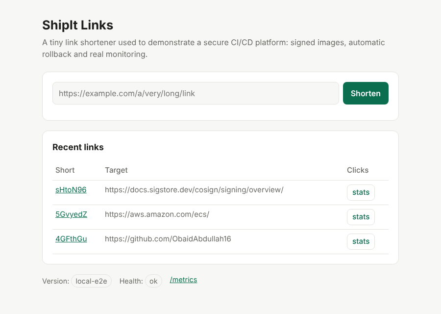
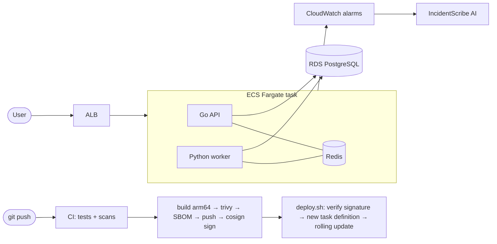

# ShipIt Platform

[](https://github.com/ObaidAbdullah16/shipit-platform/actions/workflows/ci.yml)
[](https://github.com/ObaidAbdullah16/shipit-platform/actions/workflows/release.yml)


**A secure CI/CD platform on AWS ECS Fargate: every release is tested, scanned, signed
and deployed by digest, and a bad release rolls itself back.**

> **Demo only - not production.** The link shortener holds throwaway demo data and is started only
> for demos (`up`) and stopped afterwards (`down`). The platform patterns are production-grade; the
> budget trade-offs are listed in [docs/SECURITY.md](docs/SECURITY.md).

The app is a small link shortener (Go API + Python worker + PostgreSQL + Redis) so the
interesting part is everything around it: the pipeline, the infrastructure and how it
behaves when something goes wrong.



## What this project shows

* **Supply chain security** - CI-only builds, Trivy gate, SBOM, keyless **cosign**
  signatures verified before every deploy, immutable ECR tags, SHA-pinned actions, no AWS
  keys (GitHub OIDC).
* **Safe deployments** - rolling ECS deployments with the **circuit breaker**: a release that
  fails health checks is rolled back automatically while the old version keeps serving.
  `break-it.sh` proves it, with a probe showing users saw no errors.
* **Infrastructure as code** - two Terraform stacks (registry / app), private RDS with the
  password managed by Secrets Manager, least-privilege security groups, Checkov in CI.
* **Operations** - structured JSON logs, Prometheus `/metrics`, CloudWatch alarms and a
  dashboard, a runbook, and AI incident summaries via [IncidentScribe](https://github.com/ObaidAbdullah16/incidentscribe-ai).
* **Cost control** - one-click `up` / `down`, nightly auto-stop, ~$0.10/hour while running and
  ~$0.15/month while stopped.

## Architecture



More detail: [docs/ARCHITECTURE.md](docs/ARCHITECTURE.md) ·
[docs/SECURITY.md](docs/SECURITY.md) · [docs/RUNBOOK.md](docs/RUNBOOK.md) ·
[docs/COSTS.md](docs/COSTS.md)

## Run it on your laptop (free)

Needs Docker Desktop.

```bash
docker compose up --build        # http://localhost:8080
URL=http://localhost:8080 bash scripts/loadtest.sh 30 4
docker compose down -v
```

Tests (Go 1.24+ and Python 3.12+):

```bash
cd services/api && go test ./...                      # unit tests
cd services/worker && pip install -r requirements-dev.txt && pytest -q
# integration tests run too when these point to throwaway services:
#   TEST_DATABASE_URL=postgres://...  REDIS_ADDR=localhost:6379
```

## Run it on AWS

**Once** (step by step: Project Hosting Guides / 05 - ShipIt Platform, a private guide kept outside this repository):

1. `aws-foundation` is set up (state bucket, budgets, GitHub OIDC role
   `gha-shipit-platform`) and its `up.sh` (via `connect-github.sh`) has set the `AWS_ROLE_ARN` variable here.
2. The repository is **public** (the release builds on GitHub's free `ubuntu-24.04-arm`
   runners).
3. Push to `main` (or run **Actions → Release → Run workflow**). The first release creates the
   ECR repositories, builds, scans, signs and records the images. ShipIt is not running yet,
   so nothing is deployed. (`bash scripts/up.sh` on your laptop also starts the Release workflow
   for you, and waits for it, when there is no release yet.)

**Every demo session**:

| | Actions tab → *Control (start / stop)* | Terminal (WSL) |
|---|---|---|
| Start (~10-12 min) | `up` | `bash scripts/up.sh` |
| Status / URL | `status` | `bash scripts/status.sh` |
| Bad release → auto rollback | `break-it` | `bash scripts/break-it.sh` |
| Traffic for the dashboard | `loadtest` | `bash scripts/loadtest.sh` |
| Stop (keeps the signed images, cents/month) | `down` | `bash scripts/down.sh` |
| Stop and delete everything (images too) | `down-all` | `bash scripts/down.sh --all` |

While it is up, every push to `main` that changes `services/` is deployed automatically.
Forgot to stop it? `auto-stop.yml` runs `down` at 00:00 IST every night.

Optional HTTPS on your own domain (needs a Route 53 hosted zone): set the repository
variables `SHIPIT_DOMAIN` (e.g. `shipit.example.com`) and `SHIPIT_ZONE_ID`; locally,
export `TF_VAR_domain_name` and `TF_VAR_hosted_zone_id` before `scripts/up.sh`.

## Demo script (for a 3-minute video)

1. `up` → open the URL, shorten a link, click it, show the stats (processed + pending).
2. Change the page title in `services/api/internal/httpapi/web/index.html`, push → show
   the Release run: tests, Trivy, SBOM, cosign, deploy by digest → refresh: new version.
3. `break-it` → ECS events show health checks failing → circuit breaker rolls back →
   "User-facing probes during the incident: 100% returned 200".
4. CloudWatch dashboard + the `shipit-unhealthy-targets` alarm → IncidentScribe summary.
5. `cosign verify` on the running image. `down`.

## Repository layout

```
services/api/        Go API (link shortener, /healthz /readyz /metrics, tiny Redis client)
services/worker/     Python click worker (Redis queue -> Postgres, at-least-once)
infra/bootstrap/     Terraform: ECR repositories
infra/app/           Terraform: VPC, ALB, ECS Fargate, RDS, alarms, dashboard, optional HTTPS
scripts/             up / down / status / deploy / rollback / break-it / loadtest
tools/loadgen.py     dependency-free load generator
.github/             CI, Release (build-sign-push composite action), Control, Auto-stop
docker-compose.yml   local stack
```

## Design decisions

| Decision | Why | Trade-off |
|---|---|---|
| ECS Fargate, not EKS | No cluster to pay for or patch; the EKS version lives in `kubeops-sre-lab` | Fewer knobs than Kubernetes |
| Graviton (ARM64) tasks, native ARM CI runners | ~20% cheaper, no QEMU emulation in CI | Images are arm64 only |
| No NAT gateway | Saves ~$33/month | Tasks need public IPs (locked down by security groups) |
| Redis as a sidecar | One task, no ElastiCache bill | Queue is lost if the task is replaced |
| Releases outside Terraform (`deploy.sh`) | Deploys are fast and auditable; Terraform only changes infrastructure | Two tools touch the task definition family |
| RDS-managed password | Never in state, code or logs | Small Secrets Manager cost while up |

## License

MIT
