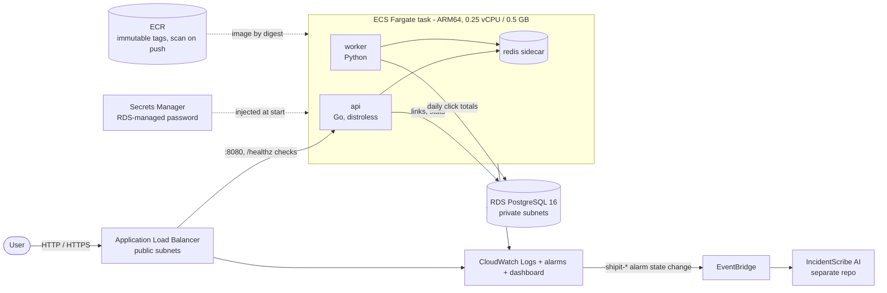
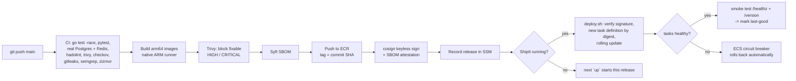

# Architecture

## Runtime (AWS, your Region - `ap-southeast-2` in the demo account)

* **Request path**: `GET /r/{code}` looks the code up in Redis (cache), falls back to Postgres,
  pushes a click event onto a Redis list and answers `302`. The worker drains that list in
  batches and adds the counts to `daily_clicks` in one transaction per batch.
* **Why a sidecar Redis?** It keeps the demo at one Fargate task. The trade-off is that the
  queue lives inside the task; in production I would use ElastiCache (or SQS) so queued
  clicks survive a task replacement.
* **No NAT gateway.** Tasks run in public subnets with a public IP so they can pull from ECR,
  but their security group only accepts traffic from the load balancer. The database is in
  private subnets with no route to the internet. This saves ~$33/month.

## Delivery pipeline

* **Only CI can ship.** `deploy.sh` and `up.sh` run `cosign verify` with the exact identity of
  this repository's `release.yml` on `main`. An image built on a laptop, or by another
  workflow, is refused.
* **Deploy by digest.** Task definitions reference `repo@sha256:…`, never a tag.
* **Infrastructure vs releases.** Terraform owns the infrastructure; releases are new task
  definition revisions registered by `deploy.sh` (`ignore_changes = [task_definition]` on
  the service), so a deploy never needs a Terraform apply.

## Two Terraform stacks

| Stack | Contents | Lifetime |
|---|---|---|
| `infra/bootstrap` | ECR repositories (immutable tags, scan on push, lifecycle policy) | Created once, kept (cents/month) |
| `infra/app` | VPC, subnets, security groups, ALB, ECS cluster/service/task, RDS, alarms, dashboard, optional ACM + Route 53 | Created by `up`, destroyed by `down` |

State lives in the shared S3 bucket from `aws-foundation` (`shipit-platform/*.tfstate`,
S3-native locking).
